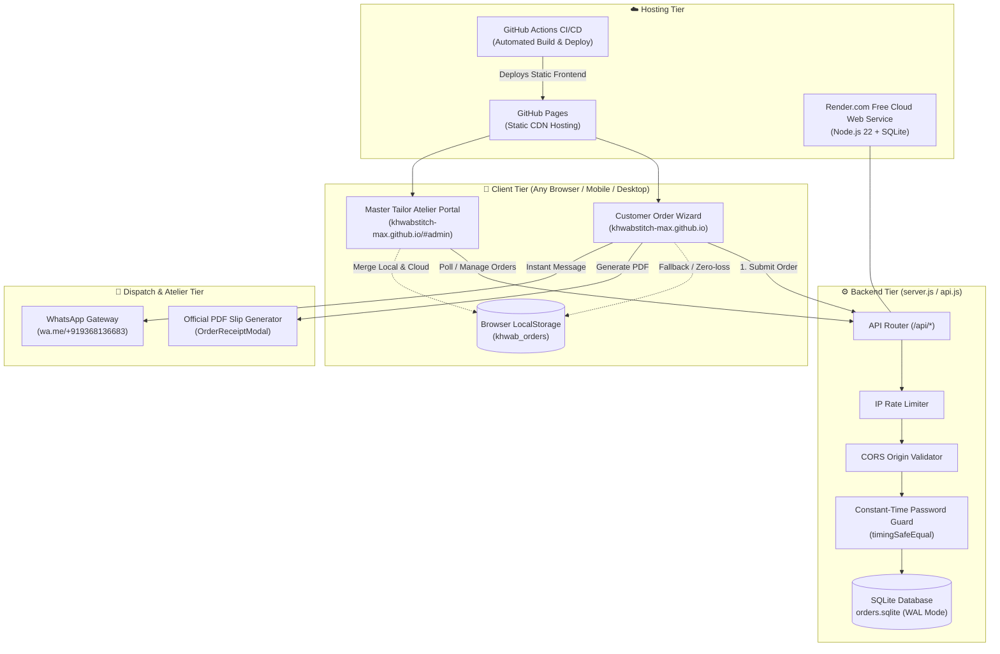
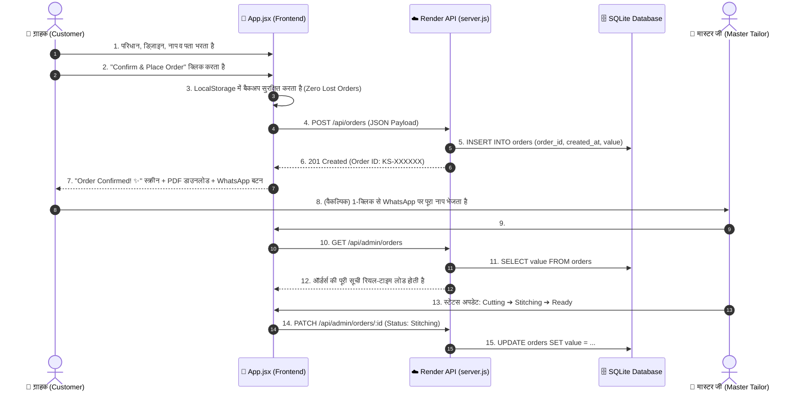

# 🪡 Khwab Stitch (ख़्वाब स्टिच) — Architecture & System Guide

> **"Where Fabric Becomes Art" / "हमारी कारीगरी"**  
> A high-performance, 100% data-driven bespoke fashion atelier web application and cloud order management system.

---

## 📌 1. Overview (यह प्रोजेक्ट क्या है?)

**Khwab Stitch** एक मॉडर्न, हाई-एंड टेलरिंग बुटीक वेब प्लेटफ़ॉर्म है जिसे खास तौर पर कस्टमाइज़्ड भारतीय परिधानों (ब्लाउज़, कुर्ती, सलवार-कमीज़/सूट) की ऑनलाइन सिलाई, सटीक नाप (measurements), कस्टमाइज़्ड डिज़ाइन सिलेक्शन और रियल-टाइम ऑर्डर मैनेजमेंट के लिए बनाया गया है।

### इसके दो मुख्य भाग हैं:
1. **Customer Order Wizard (ग्राहक पोर्टल):** मोबाइल-फ़्रेंडली 6-स्टेप विज़ार्ड जहाँ ग्राहक अपनी पसंद का कपड़ा, गला (neckline), बाज़ू (sleeves), और शरीर का नाप भरकर 1-क्लिक में ऑर्डर बुक करता है, PDF रसीद डाउनलोड करता है और वॉट्सऐप पर भेज सकता है।
2. **Master Tailor Atelier Portal (कारीगर / एडमिन डैशबोर्ड):** बुटीक मास्टर जी के लिए पासवर्ड-प्रोटेक्टेड डैशबोर्ड (`#admin`) जहाँ दुनिया के किसी भी कोने से आए ऑर्डर्स रियल-टाइम में दिखते हैं, उनका स्टेटस (Cutting ➔ Stitching ➔ Ready ➔ Delivered) बदला जा सकता है, CSV एक्सपोर्ट किया जा सकता है और ऑर्डर स्लिप प्रिंट की जा सकती है।

---

## 📁 2. File & Directory Structure (कहाँ क्या चीज़ रखी है?)

```text
khwabStitch/
├── .github/
│   └── workflows/
│       └── deploy.yml              # GitHub Actions CI/CD: ऑटो-बिल्ड और GitHub Pages डिप्लॉयमेंट
│
├── catalog/                        # 100% Data-Driven JSON कैटलॉग (बिना कोड बदले डिज़ाइन बदलने हेतु)
│   ├── brand.json                  # ब्रांड का नाम, टैगलाइन, डिफ़ॉल्ट फ़ोन, वेबसाइट, लोगो
│   ├── outfits.json                # परिधान प्रकार: Blouse, Kurti, Suit Upper
│   ├── designCodes.json            # रेडीमेड डिज़ाइन कोड्स (B-01, K-01, etc.)
│   ├── fabrics.json                # कपड़े के प्रकार: Cotton, Silk, Georgette, etc.
│   ├── neckFront.json              # 8 फ्रंट नेकलाइन्स (Round, V-Neck, Boat, Collar, etc.)
│   ├── neckBack.json               # 8 बैक नेकलाइन्स (Simple, Deep, Cutout, etc.)
│   ├── sleeveLengths.json          # बाज़ू की लंबाई (Sleeveless, Half, 3/4, Full)
│   ├── sleeveDesigns.json          # 11 स्लीव डिज़ाइन्स (Straight, Puff, Bell, Bishop, etc.)
│   ├── measurementConfigs.json     # हर परिधान के लिए आवश्यक नाप के फ़ील्ड्स व गाइड इमेज
│   └── README.md                   # कैटलॉग स्ट्रक्चर गाइड
│
├── components/                     # रीयूज़ेबल रिएक्ट कंपोनेंट्स
│   ├── StepHeader.jsx              # टॉप हेडर: ब्रांड लोगो, लैंग्वेज स्विच (EN/HI), 6-स्टेप प्रोग्रेस बार
│   ├── WelcomeStep.jsx             # स्टेप 1: लक्ज़री बुटीक वेलकम और स्टार्ट स्क्रीन
│   ├── AdminLoginPage.jsx          # कारीगर लॉगिन स्क्रीन (सुरक्षित पासवर्ड प्रॉम्प्ट)
│   ├── AdminDashboard.jsx          # मास्टर टेलर पोर्टल (ऑर्डर लिस्ट, फ़िल्टर, स्टेटस पाइपलाइन, CSV)
│   ├── OrderReceiptModal.jsx       # अधिकृत PDF / प्रिंट रसीद मोडल (वाटरमार्क, QR/बारकोड, नाप ग्रिड)
│   ├── DesignArt.jsx               # वेक्टर/कैनवास विज़ुअलाइज़र
│   ├── DesignCodeDropdown.jsx      # कैटलॉग कोड क्विक-पिकर
│   └── steps/                      # ग्राहक विज़ार्ड के मुख्य स्टेप्स
│       ├── CustomerDetailsStep.jsx # स्टेप 2: ग्राहक नाम, 10-अंक वॉट्सऐप, राज्य, शहर, पिन कोड
│       ├── OutfitSelectionStep.jsx # स्टेप 3: परिधान चयन, फ़ोटो अपलोड या कैटलॉग कोड, कपड़ा
│       ├── DesignSelectionStep.jsx # स्टेप 4: गला (आगे/पीछे), बाज़ू (लंबाई/कट), अतिरिक्त निर्देश
│       ├── MeasurementsStep.jsx    # स्टेप 5: डायनामिक नाप इनपुट (इंच/सेमी), गाइड विज़ुअल गाइड
│       └── DeliveryAddressStep.jsx # स्टेप 6: डिलीवरी पता, रिव्यू समरी, गोपनीयता सहमति
│
├── config/
│   ├── fashionCatalog.js           # मास्टर कैटलॉग रजिस्ट्री, O(1) डिक्शनरी मैप्स, फ़ोन नॉर्मलाइज़र
│   └── HOW_TO_ADD_NEW_STYLES.md    # नए डिज़ाइन जोड़ने की स्टेप-बाय-स्टेप गाइड
│
├── context/
│   └── LanguageContext.jsx         # अंग्रेज़ी (English) और हिंदी (Hindi) का ग्लोबल स्टेट प्रोवाइडर
│
├── data/
│   └── orders.sqlite               # लोकल SQLite डेटाबेस (WAL मोड, ऑटो-इंडेक्सिंग)
│
├── public/                         # स्टैटिक एसेट्स (इमेज, आइकन्स)
│   └── images/
│       ├── brand/                  # Khwab Stitch लोगो व ब्रांडिंग
│       ├── outfits/                # परिधान थंबनेल्स (01_blouse.jpg, 02_kurti.jpg, ...)
│       ├── design_codes/           # कैटलॉग डिज़ाइन्स (B-01.jpg, K-01.jpg, ...)
│       ├── neck_front/             # 8 फ्रंट गले की हाई-डेफ़िनिशन अनमास्क्ड तस्वीरें
│       ├── neck_back/              # 8 बैक गले की तस्वीरें
│       ├── sleeve_lengths/         # बाज़ू लंबाई की तस्वीरें
│       ├── sleeve_designs/         # 22 स्लीव डिज़ाइन्स (फ्रंट व साइड व्यूज़)
│       └── measurement_guides/     # नाप लेने के सचित्र चार्ट (कुर्ती, ब्लाउज़, आदि)
│
├── server/                         # सिक्योर बैकएंड API इंजन
│   ├── api.js                      # REST API मिडलवेयर (SQLite DatabaseSync, रेट लिमिट, CORS, ऑथ)
│   └── api.test.js                 # ऑटोमेटेड यूनिट व इंटीग्रेशन टेस्ट्स (Node.js test runner)
│
├── .env.example                    # पर्यावरण वेरिएबल्स का टेम्प्लेट
├── App.jsx                         # मुख्य रिएक्ट एप्लिकेशन रूट (राउटिंग, स्टेट, सिंक)
├── index.html                      # HTML5 एंट्री पॉइंट
├── main.jsx                        # रिएक्ट DOM माउंटिंग
├── package.json                    # डिपेंडेंसीज़ और स्क्रिप्ट्स (`npm start`, `npm run build`, `npm test`)
├── render.yaml                     # Render.com क्लाउड डिप्लॉयमेंट ब्लूप्रिंट (100% Free Plan)
├── server.js                       # प्रोडक्शन HTTP/API सर्वर (स्टैटिक फ़ाइलें + API रूट्स)
├── styles.css                      # लक्ज़री बुटीक थीमिंग, टेलविंड कस्टम यूटिलिटीज़
└── vite.config.js                  # Vite बिल्ड कॉन्फ़िगरेशन + Dev API मिडलवेयर + Env इंजेक्शन
```

---

## 🏛️ 3. System Architecture (सिस्टम आर्किटेक्चर)



---

## 🔄 4. Data Flow (ऑर्डर कैसे प्रोसेस होता है?)

### Step-by-Step Order Lifecycle:



---

## 🛡️ 5. Security & Reliability Highlights

1. **Dual-Layer Persistence (जीरो लॉस्ट ऑर्डर्स):**
   - यदि इंटरनेट धीमा हो या सर्वर पर लोड हो, तब भी ग्राहक का ऑर्डर ब्राउज़र के `localStorage` में पहले बैकअप होता है, फिर बैकएंड से सिंक होता है। कोई भी ऑर्डर कभी मिस नहीं हो सकता।
2. **Timing-Safe Admin Authentication:**
   - एडमिन पासवर्ड की जांच `crypto.timingSafeEqual` से होती है, जिससे ब्रूट-फ़ोर्स या टाइमिंग अटैक का ख़तरा नहीं रहता।
3. **Smart IP Rate Limiting:**
   - किसी भी स्पैम या बॉट से सुरक्षा के लिए 60 सेकंड में अधिकतम 10 ऑर्डर रिक्वेस्ट की सीमा निर्धारित है।
4. **Resilient CORS Engine:**
   - GitHub Pages (`khwabstitch-max.github.io`), Render बैकएंड, और लोकलहोस्ट पोर्ट्स (`5173`, `3000`, `5174`) सभी सुरक्षित रूप से ऑथराइज़्ड हैं।
5. **No Double Country Code Bug:**
   - `getWhatsAppPhone()` हेल्पर सुनिश्चित करता है कि भारतीय मोबाइल नंबर में कभी भी दो बार `9191` न जुड़े और हमेशा मान्य 12-अंक लिंक (`wa.me/91XXXXXXXXXX`) बने।

---

## 🚀 6. Environment Variables Guide (`.env`)

| Variable Name | Description | Default Fallback |
| :--- | :--- | :--- |
| `ADMIN_PASSWORD` | मास्टर टेलर एडमिन पासवर्ड | `Dhaniya123` |
| `VITE_ADMIN_PASSWORD` | फ़्रंटएंड एडमिन प्रमाणीकरण पासवर्ड | `Dhaniya123` |
| `VITE_WHATSAPP` | बुटीक अधिकृत वॉट्सऐप हेल्पलाइन | `+91 93681 36683` |
| `VITE_INSTAGRAM` | इंस्टाग्राम प्रोफ़ाइल हैंडल | `@khwabstitch` |
| `VITE_WEBSITE` | आधिकारिक वेबसाइट लिंक | `https://khwabstitch-max.github.io/khwab-stitch/` |
| `VITE_API_BASE_URL` | लाइव क्लाउड बैकएंड URL | `https://khwab-stitch.onrender.com` |
| `PORT` | बैकएंड सर्वर पोर्ट | `3000` |
| `DB_PATH` | SQLite डेटाबेस फ़ाइल का पाथ | `data/orders.sqlite` |

---

## 🛠️ 7. Quick Commands (जरूरी कमांड्स)

* **डेवलपमेंट सर्वर शुरू करने के लिए:**
  ```bash
  npm run dev
  ```
* **लोकल प्रोडक्शन बैकएंड व डेटाबेस चलाने के लिए:**
  ```bash
  npm start
  ```
* **ऑटोमेटेड टेस्ट सूट रन करने के लिए:**
  ```bash
  npm test
  ```
* **प्रोडक्शन रेडी फ़्रंटएंड बंडल बनाने के लिए:**
  ```bash
  npm run build
  ```

---

*दस्तावेज़ संस्करण: 2.0 · ख़्वाब स्टिच आर्किटेक्चर टीम*


proper attractive looking like cloth and stitch website , smooth easy to use for customer