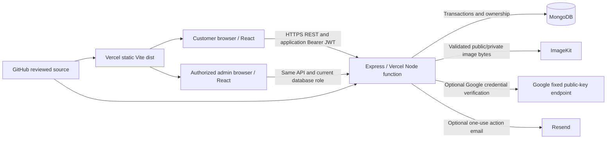
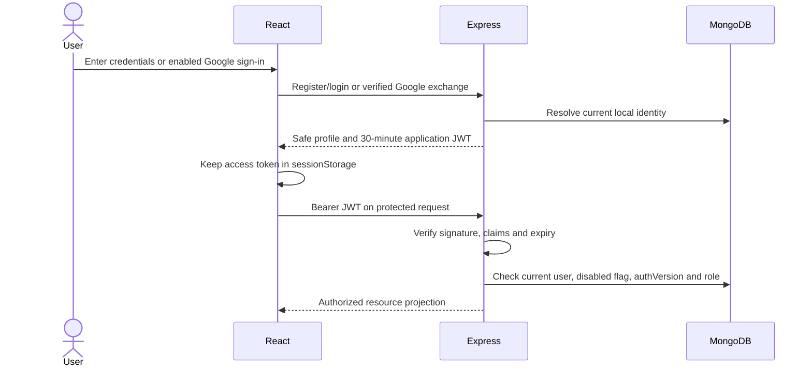
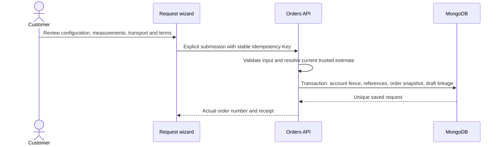

# High-level design

Updated 2026-11-10 for the owner's explicit GitHub + Vercel deployment target. This document describes current repository architecture, not a production deployment or fresh provider verification. [Project status](project-status.md), the [requirement matrix](requirement-matrix.md), [verification](review-verification.md) and [production readiness](production-readiness.md) distinguish implementation from configuration. Previous Render deployment instructions are superseded for the current rollout; the standalone entry remains for compatibility. Use [Vercel deployment](deployment-vercel.md).

## System shape

Khwab Stitch is a React/Vite frontend and an Express modular monolith using Mongoose/MongoDB. GitHub is the intended source and Vercel serves the built frontend plus one Node serverless API entry. `vercel.json` routes `/api` and health requests to `api/index.js`; filesystem assets are resolved before the React SPA fallback. MongoDB and ImageKit provide durable business and image storage. The API owns authorization, validation, availability, prices, transactions and state changes. Browser state is never authoritative for roles, ownership or money.

Frontend routes are grouped into public catalogue, request configuration, customer account/order, worker and administrator areas. Shared styling and reusable option cards/dialogs apply across the existing brand identity. Fonts use local/system fallbacks rather than a new external font dependency. English/Hindi presentation changes labels and optional authored content, not API enums, ownership or submitted values.

The frontend API base is build-time public configuration. Database credentials, JWT signing material, ImageKit private credentials and mail credentials are server-only. Use independent credentials, databases, storage configuration and origins per environment.

## Domain boundaries

| Boundary | Responsibility and principal implementation |
|---|---|
| Authentication | Local accounts, password hashing, short-lived JWTs, current-user/role checks; optional Google subject linking and emailed actions. `auth.js`, `credentials.js`, `routes-auth.js`, `routes-google.js`, `routes-security.js` |
| Public catalogue | Published designs, compatible active options, settings and matched published guides. `routes-public.js`, `visual-catalogue.js` |
| Trusted pricing | Current catalogue defaults, independent component adjustments, zero sleeve-length fee, pending work, transport legs and configuration fingerprint. `pricing.js` |
| Drafts and submission | Owned versioned drafts, explicit submission, reference validation, retry keys and immutable request/estimate snapshots. `routes-drafts.js`, `routes-orders.js` |
| Order operations | Versioned quotes, fresh customer acceptance, production transitions and separately attributable logistics facts. `routes-admin.js`, `domain.js` |
| Account and care | Profiles, measurement profiles, contextual conversations, assistance/complaints and customer-accepted draft proposals. Account/support/proposal route modules |
| Approved work | Applications, separate worker/assistance capabilities, individual assignments and restricted job projections. `routes-workers.js` |
| Visual administration | Option/guide CRUD, publication/archive/reference checks, images and provenance. `routes-admin.js`, `visual-catalogue.js` |
| Media | Authenticated validation/upload, provider metadata checks, public/private purpose separation, access links and reference lifecycle. `routes-media.js`, `media-storage.js`, `imagekit.js` |
| Benefits and credits | Disabled-by-default configured offers, referral claims, immutable credit ledger, quote-benefit commitment/reversal and delivery rewards. `commerce-input.js`, `commerce-models.js`, `commerce-service.js`, `commerce-routes.js` |
| Serverless lifecycle and limits | Cached application/connection initialization, bounded MongoDB pool, required index checks and shared production request counters. `serverless.js`, `rate-limits.js`, `deployment-indexes.js` |

The same model factory creates the core and extension collections. Domain modules use the same MongoDB transaction boundary rather than introducing a second identity or order store. Index creation and data migrations are explicit operator steps; application startup does not reset or seed customer data.

## Identity and trust

Email/password and application JWTs remain authoritative. Optional Google Identity Services credentials are accepted only at exchange/link endpoints, verified by fixed-source RS256 keys and issuer/audience/expiry/subject, then exchanged for the same application JWT. A matching Google email cannot claim an existing password account: linking additionally requires the existing user's current password. Firebase is not an active authentication dependency; retained legacy identifiers do not authorize a request.

There are no refresh tokens or authentication cookies. Successful server logout, password reset/change and trusted access changes revoke older JWTs through `authVersion`. Local logout clears immediately and uses the captured old token for bounded remote revocation; an old completion cannot erase a newer account/draft. Temporary verification failures preserve the session and allow retry without redirecting or unmounting an already verified private form. Credential rejection is distinct from JWT rejection. See [authentication](authentication.md). Optional reset/verification actions use expiring one-use hashed tokens and configured email delivery; absent configuration is not a verified email/recovery service. Google-only account passwords remain with Google.

Customer IDs and references are checked on the API, including upload finalization and order transactions. Customer resources are owner scoped. Workers require current approval/capability and assignment; approval does not grant admin rights. Support context is shared by explicit customer consent and worker assignment/permission is rechecked. Notifications avoid copying private bodies.

## Configuration, pricing and measurement flow

A catalogue request can preserve **Same as shown** or customize only chosen components. Each component can retain the original, use a published option, follow an owned private reference or request guidance. Mixed sources remain supported. Switching a part does not erase unrelated details. A draft can retain parked choices for recovery while the submitted effective configuration excludes suppressed instructions.

The backend resolves configuration against current published designs/options. Included components and included extras are not billed again. Front-neck, back-neck and sleeve-design adjustments are separate, missing prices remain pending, garment charges scale by quantity and transport charges apply once per leg. The initial estimate is separate from optional benefits on an itemized final quote. Commerce is implemented but disabled by default; no programme rates or eligibility terms are invented or activated.

Every sleeve-length preference adds zero. UI controls, input normalization, public projections and trusted new-estimate calculation enforce this independently of stored legacy amounts. Sleeve design has a separate configured price that cannot increase silently with length. Compatibility is a feasibility constraint: unknown rules need review and explicit incompatible rules block a selection. Existing accepted quotes and submitted orders are preserved.

Measurements distinguish the person taking them (`self`, `tailor`, `assistance`) from what is measured (`body`, `garment`, or legacy/explicit assistance). Guide matching uses garment, body/garment method and interface language, with language-neutral fallback. The same rule serves self and own-tailor measurements. No matching guide yields a clear help fallback; another garment's image is not substituted. Illustrative values never prefill actual measurements.

## Draft persistence and submission

Guest drafts have an opaque device-local identifier. Ordinary design choices persist in local storage for 30 days; personal measurements, addresses, notes and private reference details remain in tab session storage. This is a recoverable browser draft, not a cross-device guest account. Authenticated cloud drafts are owner scoped, revisioned MongoDB records. Private uploads require authentication.

Login continuation carries an internal route/draft identifier and restores the request without submitting it. Final submission is explicit. The API rechecks service/design/option availability, ownership of private media, used guide compatibility, policy version and acknowledged estimate/draft revisions inside the order transaction.

An identical retry returns the saved request; changed payload with the same key conflicts. Stale revisions, prices or policies require review. The browser does not automatically retry mutations. Changes to catalogue entries, profiles and measurement profiles do not rewrite submitted order snapshots.

## Quotes, operations and care

Administrators review requests and send versioned final quotes with exact row totals. Only a response to the current quote/version/revision accepts it. The accepted snapshot is immutable; generic status changes cannot skip acceptance. Production progresses through recorded fabric receipt, stitching, ready, dispatch and delivery. Logistics facts and completion/delay notes are separate from the operational stage and accepted price.

When an administrator enables a defined programme, a customer may save an eligible offer/credit selection against the current itemized quote. A pending selection does not debit a wallet. Explicit current-quote acceptance revalidates availability, terms, offer limits and balance inside the order transaction, records the ledger/use and snapshots gross amount, discount, credits and net amount in `acceptedQuote`. Benefits apply to identified stitching rows, never transport. Cancellation/rejection restores committed credits and offer capacity once; a recorded qualifying delivery can issue configured referral/milestone rewards once. Unique events, conditional balances and owner fences prevent repeated redemption/rewards. See [commerce](commerce.md).

Contextual support/conversations are persistent records. A reply, human first response and resolution are distinct. Configured support calendars establish response targets, not guaranteed callbacks or correction completion times. Staff can propose component changes only to an editable owned shared draft; explicit current customer acceptance and price/revision checks apply.

Worker progress is a proposal for admin review rather than an automatic customer status update. Reviews require an eligible delivered owned order, are unique per order and need public-display consent before moderation/publication. Public selected testimonials are not a complete-review or aggregate-rating claim.

## Visual inventory and storage responsibilities

The prepared inventory accounts for 62 supplied files and preserves originals. Seven contact sheets, duplicate/ambiguity notes, source hashes and crop metadata are under [artifacts/visual-import](../artifacts/visual-import/). Supplied individual files have whole-image coordinates; no missing parent-board coordinates or designs are invented.

The historical configured import run recorded 31 option drafts and 3 garment-guide drafts using 47 public catalogue assets; repeat import recorded zero additional uploads. These are prior-run records, not a fresh connection, import, current remote count or publication claim in this review. No environment files or live providers were inspected for the current work. Preparation manifest flags describe staging. Garment applicability, compatibility and actual prices require owner approval. The clipped ruffle-front image remains quarantined. Body guides were not supplied.

MongoDB stores public catalogue metadata, revisions, provenance and media references; ImageKit stores uploaded image bytes. Draft option records are unlisted configuration, while their public catalogue image bytes are not a secrecy boundary. Customer images are a different private purpose and never enter that public import path. Existing bundled approved board/brand assets remain static application files with allowlisted media support.

Orders snapshot selected option labels, media references, pricing and immutable used-guide instructions/method/image IDs, and pin referenced images. Shared-media reference counts, exact public pin records, target reference fences and usage checks protect current and historical associations against concurrent deletion. Permanent deletion is restricted to unused records; archival preserves meaning.

## Deployment and operational boundaries

The Vercel entry imports the serverless handler without calling `listen` or loading environment files. It uses hosting-provided configuration. A pending application/connection initialization is shared within each warm instance; failed initialization clears the pending cache so later requests can recover. The pool is bounded to five connections with no minimum idle pool. This cache is not shared business state and is not a global connection cap across scaled instances. Required indexes must already exist. Startup failure returns a safe 503. MongoDB transactions require a compatible deployment. Function disk/memory is not durable order, ledger or image storage. Health readiness does not verify every external provider.

CORS uses explicit configured origins; the default same-origin `/api` avoids a separate browser API host. Production request limits use MongoDB `RequestLimit` buckets, unique counter keys and TTL cleanup, shared across function instances. Failure to update the durable limit fails closed. Password/image concurrency gates remain per-instance CPU protection, while daily upload quotas live in MongoDB. Same-origin JavaScript can read session storage, so XSS prevention remains essential. Browser image preparation keeps files within the3 MiB proxy budget; the server still decodes and enforces privacy. See [ImageKit/media](imagekit.md).

ImageKit operations cannot share a database transaction. Failed upload compensation or deletion requires operator reconciliation rather than a claimed atomic provider success. Private media fails closed until the operator verifies the provider's unsigned-original/transformation policy.

The retained standalone Node entry and `render.yaml` are compatibility/history, not the current rollout target. Commercial hosting requires a Vercel plan that permits this use; no purchase or deployment is claimed. Real orders still require approved prices/guides/programme terms, provider privacy/auth/mail checks, backups/restore, alerts and a deployed smoke test. See [Vercel deployment](deployment-vercel.md), [capacity](capacity-plan.md), [operations](operations.md) and [readiness](production-readiness.md). Courier booking, cash payments/refunds, payroll and future craft adapters are not simulated.

For detailed models, API and consistency rules see [LLD](lld.md), [enhancement API](enhancement-api.md) and [account/support API](account-support-api.md). Customer/admin instructions are in [customer workflow](customer-workflow.md) and [admin guide](admin-guide.md).
