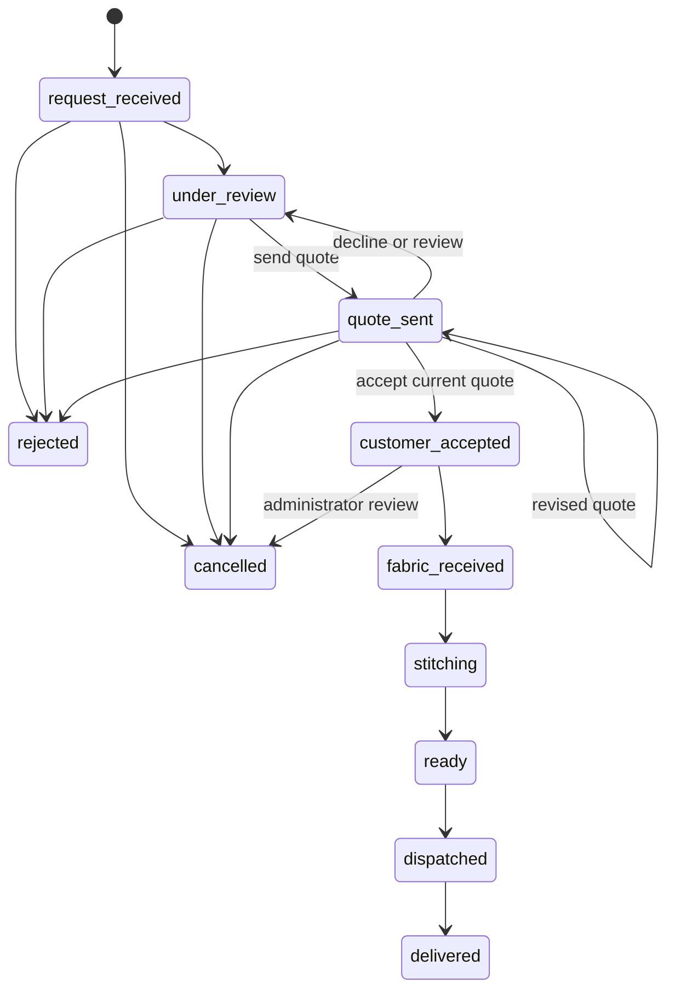

# Low-level design

Updated 2026-11-10. JavaScript is used throughout. GitHub + Vercel is the owner's current deployment target; older Render deployment instructions are superseded for rollout, while the standalone Node entry remains compatible. Use [Vercel deployment](deployment-vercel.md). Current exact evidence belongs in [verification](review-verification.md), [project status](project-status.md) and [readiness](production-readiness.md). Older reports are historical; no environment files or external providers were accessed for this review. Free sleeve lengths, current guides, auth recovery and optional commerce below take precedence over earlier descriptions.

## Modules

| Area | Principal files and responsibilities |
|---|---|
| Request UI | `client/src/pages/RequestFlow.jsx`: conditional component steps, measurements, guide matching, separate logistics, review edits, login continuation and explicit submission |
| Browser drafts | `client/src/lib/drafts.js`: validated local IDs, ordinary/private storage separation, retention and optimistic local revisions |
| Shared catalogue UI | `VisualOptions.jsx`, `MeasurementGuides.jsx`, `CatalogueImages.jsx`: accessible cards, available views, matching guide fallback and public-image management |
| Account/admin UI | Account, Orders, Security, Admin, AdminOperations, AdminServices and AdminMeasurementGuides pages; current bounded pagers and separate form/editor state |
| Core domain | `server/src/domain.js`, `workflow-input.js`, `pricing.js`: strict inputs, measurements, configuration, quotes/state transitions and authoritative estimates |
| Routes | Public/auth/order/admin/media plus account, drafts, security, Google, support, proposals, reviews, workers, services and visual-catalogue modules |
| Persistence/media | `models.js`, `models-extension.js`, `route-utils.js`, `media-storage.js`, `imagekit.js`: schemas, transactions, reference counts and provider adapter |
| Serverless lifecycle | `api/index.js`, `serverless.js`, `deployment-indexes.js`: one cached initialization per warm instance, pool bounds, required-index checks and safe failure; no `listen` or environment-file load |
| Shared request limits | `rate-limits.js`: Mongo-backed production rate counters; process-local hashing/image gates remain separate CPU controls |
| Benefits | `commerce-input.js`, `commerce-models.js`, `commerce-service.js`, `commerce-routes.js`: owner-configured disabled-by-default offers/referrals/credits, quote snapshots, ledger and rewards |
| Upload preparation | `client/src/lib/media.js`:5 MiB source/24 MP checks, no-upscale browser preparation to3 MiB and shared authenticated multipart upload |
| Operator tools | Index/admin/password/account/media scripts; visual preparation/import; controlled free-length migration. These are not public browser role-grant endpoints |

## Data conventions

All timestamps are UTC. Business date-only validation uses Asia/Kolkata. Money is non-negative integer INR paise; client amounts never determine an estimate. Measurement unit and method are explicit. Mongoose schemas use timestamps, strict fields, no automatic version key and explicit integer `revision`. Atomic mutations compare the expected revision, increment it and write attributable history/audit data in the transaction where required.

The model factory creates core and extension collections on the same connection. Production index creation is explicit through `npm run db:indexes`; startup checks required index definitions rather than silently replacing them. No application startup reset, seed, destructive backfill or automatic owner migration is introduced.

## Models and relationships

| Model | Important fields and constraints |
|---|---|
| User | Normalized email/name, private passwordHash and optional emailReservation, role customer/admin, disabled, authVersion, mutationFence, upload quotas, deletion markers. Legacy firebaseUid is retained metadata, not active authentication |
| RequestLimit | Hashed namespace/key, fixed time bucket, hit count and expiresAt; unique key/bucket plus TTL cleanup. Production requests share counters across function instances |
| AccountIdentity / PasswordAction | Unique owner identity with optional private unique Google subject/provider-email metadata and emailVerifiedAt. Action stores unique SHA-256 tokenHash, reset/verify kind, owner, expiry and usedAt |
| Category / Design | Unique category slug and design code/slug, garment/category, bilingual content, integer starting price/rate tiers, ordered media/views and cover crop, status/revision/usedCount, defaults by component kind and includedAddonIds |
| DesignOption | Stable optional unique code; kind, garments, names/descriptions/alt, ordered image IDs, status/active/displayOrder, priceMode/amounts, measurementFields, sleeve metadata/lengthStyle/compatibility, material coverage, provenance/importKey/importDigest, usedCount/referenceFence/revision |
| MeasurementGuide | Unique code, garment, body/garment method, en/hi/und language, names/instructions, explained measurement keys, ordered public image IDs, status/displayOrder, sourceCrops/import metadata, usedCount/referenceFence/revision |
| MediaAsset | Owner, unique provider fileId, storage kind/path, purpose/privacy, decoded MIME/size/dimensions, references and deletingAt. Image bytes stay at the provider or approved bundled static path |
| Draft | Owner, clientId, bounded data, title, draft/submitted status, revision and resulting orderId. Private-media references are pinned/released when edited or finalized |
| Order | Owner, unique orderNumber and owner/idempotencyKey, requestHash, immutable submitted request/design/estimate and guideSnapshots, exact publicMediaPins, effective configuration, measurements/guide IDs, logistics, policyVersion, draft reference, status/revision, versioned quotes/acceptedQuote including committed benefits, history and separate fulfilment facts |
| AccountPreferences / MeasurementProfile | Owned addresses/communications and named garment/unit/method/value profiles. Revisioned edits affect future choices, not existing orders |
| Conversation / Message | Context kind/ID and owner; bounded messages/private attachments, sender/clientId uniqueness and read timestamps. Current context ownership/assignment is authorized on each operation |
| SupportTicket / SupportProposal | Owned retry/hash/ticket number, consented draft/order context, status/history/response timing, assigned staff and conversation. Proposal stores component-only changes, price/measurement impact and expected draft/proposal revisions |
| WorkerApplication / WorkerProfile / WorkAssignment | Private application/portfolio/terms/retry data; separately active and assistance-capable worker; assigned order/worker/requirements/deadline/conversation/progress/history/revision |
| Review / Notification / ServiceDefinition | Eligible unique delivered-order review with original rating/text/consent and moderation; owned safe notifications; service taxonomy, material rules, components/measurements/stages/skills and active status |
| CommerceSettings / CommerceOffer | Singleton disabled feature flags/terms/redemption and reward rules; unique offer code with draft/published/archived state, garment/time/minimum/cap and use limits |
| CommerceWallet / CommerceLedger | Unique owner wallet/referral code, non-negative integer balance and revision; append-only ledger with owner/eventKey uniqueness, signed delta, resulting balance, reason and request hash |
| CommerceReservation / CommerceOfferUse | Unique order/quoteVersion selection and preview with pending/committed/released state; committed/released offer use for the same version |
| CommerceReferral / CommerceMilestone / CommerceCompletion | One referral per referred owner, one milestone per owner/code and one qualifying completion per order; unique reward events prevent duplicate issuance |

Component kinds are `sleeveLength`, `sleeve`, `neck` (front), `back`, `fit` and `extra`. Sleeve-length style is a preference enum, not the customer's numeric `measurements.values.sleeveLength`. Both remain separate from sleeve-design construction metadata.

Key indexes include:

- Unique credential email with its partial filter; unique private emailReservation; unique identity owner and partial unique Google subject.
- Unique draft owner/clientId and owner/status/updatedAt; unique order owner/idempotencyKey and orderNumber; owner/status/date/ID list indexes.
- Unique design code/slug, category slug and optional option code; guide code and guide status/garment/method/language/displayOrder.
- Unique message conversation/sender/clientId, eligible review order and retry constraints on support/work records.
- Password-action token hash uniqueness plus expiry TTL; audit resource/time and media reference/age indexes.
- Unique RequestLimit key/bucket and expiresAt TTL; exact deployment-index checks prevent production from starting without durable limiter/commerce uniqueness constraints.
- Commerce wallet owner/referralCode, ledger owner/eventKey, reservation/use order/quoteVersion, referred owner, milestone owner/code and qualifying completion order uniqueness.

TTL cleanup is not the action's security check: expiry and one-use validity are enforced transactionally. Optional fields preserve legacy data. Index changes must inspect definitions and remove only the reviewed obsolete identity index; they must not drop unrelated data or indexes.

## Authentication and permissions

`POST /api/auth/register {name,email,password}` and `POST /api/auth/login {email,password}` return `{data:{token,expiresAt,user}}`. Passwords use bcrypt cost 12, a minimum of 12 Unicode code points and maximum of 72 UTF-8 bytes. Safe projections exclude hashes. Login uses a generic invalid-credentials error and bounded hashing/rate limits.

JWTs use HS256, a 30-minute expiry, issuer `khwab-stitch-api`, audience `khwab-stitch-web`, MongoDB user subject and authVersion. `JWT_SECRET` is canonical base64url encoding of at least 48 random decoded bytes. Each protected request loads the current account, checks disabled/authVersion and uses its current database role. A caller-supplied role or legacy Firebase identifier is never trusted.

Tokens are held in tab session storage. There are no refresh tokens or authentication cookies. Successful `POST /api/auth/logout {}` revokes existing sessions by incrementing authVersion; password reset/change and trusted role/access changes also revoke. The browser clears locally before awaiting remote logout, using the captured old token for revocation. A late old response cannot erase a newer account/draft. Profile verification retries remain recoverable; latest-request/session generations prevent stale refresh responses, and a failed refresh preserves a verified form's entered values. Password/Google credential rejection is distinct from session401; disabled403 clears the account while ordinary forbidden403 does not. See [authentication](authentication.md). Password CLI input is hidden, never passed on the command line.

Optional Google exchange verifies a credential's RS256 signature, fixed key source, issuer/audience/expiry and subject, then issues the same local JWT. Existing password accounts require current-password proof before subject linking. Matching provider email alone does not establish ownership. Google-only users do not receive an unsupported local-password reset/change path.

Optional verification/reset actions require configured Resend delivery. Only hashed, bounded one-use secrets are stored; email action URLs put the secret in a fragment. Provider configuration/live delivery verification is separate from mocked tests. No Firebase authorized-domain configuration is required for the current implementation.

Owner filters protect customer drafts, orders, measurements, support, reviews and notifications. Admin middleware verifies the current role on the backend. Worker active/assistance flags and current assignment are separate capabilities; job projections exclude customer prices and unrelated personal data. Assignment revocation removes context access immediately.

## API conventions and visual contracts

Base path is `/api`; health endpoints are outside it. Success is `{data:...}`; lists also return `{pagination:{page,limit,total,pages}}`. Errors use `{error:{code,message,requestId,details?}}`. Inputs use allowlisted fields, validated IDs, bounded search/filter values and stable list sorts. Page size is at most 50.

Use 400 for validation, 401 for missing/expired/revoked credentials, 403 for prohibited role/account, 404 for hidden/missing resources, 409 for stale revision/state/quote/key/reference conflict, 413 for input size, 429 for limits and 503 for dependency/configuration failure. Do not expose provider secrets or private bodies in errors/audit logs.

| Endpoint | Current behavior |
|---|---|
| `GET /api/options` | Bounded published/active compatible options with names/codes/descriptions, price status and resolved public images. Internal provenance/import fields are not part of the public projection |
| `POST /api/admin/options` | Authorized validated create, public-media reference pins and audit |
| `PATCH /api/admin/options/:id` | Full allowlisted fields plus expected revision; public-image reference differences updated transactionally |
| `DELETE /api/admin/options/:id` | Archive the option; preserve historical references |
| `DELETE /api/admin/options/:id/permanent` | Expected revision; only unused/unreferenced options can be removed; release media references |
| `POST /api/admin/options/import` | Up to 50 importKey/option entries; deterministic identity/digest makes equal imports repeatable and conflicting source changes fail |
| `GET /api/measurement-guides` | Bounded published-only guides matching garment, body/garment method and requested language or und; ordered public images |
| `GET /api/admin/measurement-guides` | Authorized bounded list across statuses with internal source metadata |
| `POST /api/admin/measurement-guides` | Validated create; published guides require an attached public catalogue image |
| `PATCH /api/admin/measurement-guides/:id` | Full guide fields plus revision; update pins and audit atomically |
| `DELETE /api/admin/measurement-guides/:id` | Body revision/permanent; archive by default, permanent delete only after usage/order/draft checks |

Guide fields include `code,name,nameHi,garment,method,language,instructions,instructionsHi,measurementFields,imageMediaIds,status,displayOrder`; internal sourceCrops/import metadata retains provenance. Option public images resolve only non-private catalogue assets not reserved for deletion. Preview dialogs support available views, keyboard dismissal and focus return.

The customer guide component requests matching guides in bounded batches of up to 20 and offers **Load more guides** through usePagedCollection; changing garment/method/language resets the match. Admin guides have page controls. Option/catalogue selectors also load more batches and filter loaded options. Account and major admin lists have bounded independent pages; paging does not reset unrelated forms/editors. Some legacy media reference pickers still use a first bounded batch. These limits must not be described as unlimited selection.

Exact broader contracts are in [API](api.md), [enhancement API](enhancement-api.md) and [account/support API](account-support-api.md).

## Pricing and compatibility

`pricing.js` resolves current design, options and settings. Its current algorithm identifier is `2026-11-free-sleeve-length-v3`. The configuration fingerprint records the current resolved inputs; stale acknowledged estimates fail instead of silently submitting a changed price.

An estimate contains lineItems, pendingItems, component/add-on snapshots, required measurement fields and configurationVersion. Garment-scope amounts multiply by quantity (1–10); shipment/order scope uses one. Base price comes from the selected catalogue design or configured garment base. Absent pricing remains pending.

For each effective component:

1. Resolve the original catalogue default or selected compatible active published option of the correct kind.
2. Preserve labels, code, revision, image IDs, measurement/material/compatibility metadata in its snapshot.
3. Add zero for an original/included component or already-included extra.
4. For additional/replacement use the explicitly configured non-negative paise; no guessed credit for an old component is subtracted.
5. For unpriced work/reference/help add a pending review item, never a fabricated amount.
6. Suppress old sleeve design/instructions and its charge when sleeveless is effective. Keep recoverable parked choices only in the draft.

**Sleeve length always has a zero adjustment in new option pricing.** `optionInput` normalizes length priceMode to included and both amount fields to zero. Public projections also normalize stale stored values; the estimate adds a zero length line regardless of legacy amount. The admin length UI omits the surcharge editor. Sleeve design is charged independently. Legacy sleevePricingMode/combinedLengthPrices metadata remains readable but does not create a new length-dependent surcharge.

Missing sleeve/length compatibility yields a review-needed item. An explicit unsupported length or incompatible pair fails with 409. Front and back necks are independent; the server never fixes an incompatible choice by silently changing the other neckline. Catalogue default mappings must use valid compatible options and no incompatible included pair. Future craft additions are rejected until an actual adapter exists.

Transport uses separate inbound/outbound selections. A business arrangement resolves the longest matching configured enabled PIN prefix; a missing service area/rate stays pending. Drop-off/collection and customer-courier selections add no business transport fee, while the latter is paid directly by the customer. This is pricing/configuration, not a carrier booking.

Final quotes are administrator-authored, versioned amounts and optional breakdown rows; rows are line totals that must sum to the amount, with quantity/scope validation. The generic row contract has no structured automatic component classifier. Operators must not introduce a sleeve-length surcharge through a manual quote. No coupon, referral, reward, credit ledger or payment processor is implemented.

## Measurements and guides

The request stores `unit:in|cm`, `method:body|garment|assistance`, optional `takenBy:self|tailor|assistance`, numeric values, notes, affected fields requiring reconfirmation and optional used guide IDs. Legacy requests without takenBy remain compatible. Who measures and what is measured are separate; own-tailor measurement does not imply garment measurement.

Kurti/suit use their applicable bust/waist/hip/shoulder/length fields; blouse includes underbust; alteration requires explanatory context and relevant dimensions. Selected options may add required fields. Sleeveless suppresses sleeve-specific requirements. Assistance can defer measurements explicitly. New configuration flows preserve legitimate unusual positive values for reconfirmation/review; older validation retains its compatible limits. Unknown, non-finite and non-applicable values remain invalid.

Published guide matching is garment + body/garment method + language/und. The selected guide cannot cause illustrated numbers to enter the measurement values. At submission used guide IDs must still be published and match garment/method; otherwise return `GUIDE_CHANGED`. New orders retain immutable guideSnapshots including used names/instructions, garment/method/language/revision and image IDs/dimensions. Used counts and exact referenced guide-image pins are recorded transactionally. Later guide edits do not rewrite that snapshot; no historical snapshot is invented for older orders that lack one.

The three supplied guides are garment illustrations imported as drafts. “Sleeve Arm” and flat-width/circumference meaning need approval; no body guide or missing field instruction is invented. No matching published guide produces the help fallback. Switching a garment/method changes the displayed guide and flags incompatible/affected measurements for reconfirmation while retaining recoverable draft values.

## Draft persistence and order creation

Browser draft keys use an opaque ID under `khwab:request:v2:`. OrdinaryData is an explicit allowlist of design choices and progress with 30-day local-storage retention. The full private version is written to tab session storage first; failure never falls back to storing private fields persistently. Local expected revisions detect competing writes. No passwords are saved in drafts.

Authenticated draft records use owner/clientId uniqueness and revision checks. Login continuation contains an internal return path and draft identifier, not private details in query strings. It restores review without automatically mutating the order store. Editing one section operates on that section; Save/Cancel preserves unrelated draft data.

`POST /api/orders` requires an authenticated owner and a stable 16–128 character ASCII letter/digit/underscore/hyphen Idempotency-Key. The canonical request hash and unique owner/key guarantee identical replay returns the same receipt and changed payload conflicts.

In a MongoDB transaction, creation fences the active account, checks service/design availability, resolves the trusted estimate, validates current policy and supplied estimate/draft revisions, validates owned private reference attachments and used guides, pins selected public images, increments usage, creates immutable request/estimate/design snapshots and links/finalizes the editable owned draft. Effective submitted configuration omits suppressed components; parked browser choices are not current worker instructions. No browser amount or role is trusted.

## Quotes and state transitions

Order mutations atomically match ID/revision/current state and append actor/time/history/audit. Quote versions strictly increase. Customer response requires current quoteVersion, expected revision and quote_sent state; acceptance copies the exact accepted quote. General status edits cannot skip customer acceptance. Accepted snapshots cannot be silently rewritten by later catalogue/option/profile updates or the free-length migration.

Fulfilment facts use the same revision but a separate history: inbound/outbound transport status, known courier link, completion estimate, delay reason, address reconfirmation and alteration-margin exceptions. These do not change accepted pricing or automatically progress stitching.

## Offers, referrals and credit settlement

Commerce settings and all benefit flags default disabled with no invented reward amounts, redemption percentage or programme terms. Administrators own those values. An offer is a fixed amount or a basis-point percentage with explicit garment, validity, minimum stitching and use constraints. A published offer is not a guarantee of eligibility for every order.

Only an itemized final quote whose line totals match its amount supplies the eligible stitching base (`scope:"garment"`). Transport is excluded. Saving offerCode/creditPaise against the current order revision and quote version creates/updates a pending preview, without debiting or globally reserving the wallet. Multiple pending selections do not promise balance availability.

Current-quote acceptance calls the commerce service inside the existing order transaction. It revalidates settings/offer revision, dates, limits and available balance, matches the preview, conditionally debits the non-negative wallet, records unique offer use/ledger events and commits the reservation. `acceptedQuote` snapshots gross amount, stitching base, discount, credits and net amount. Retry/stale/concurrent conflicts cannot charge the same credit event twice. Historical accepted quotes remain unchanged by later settings or catalogue edits.

Cancellation/rejection releases committed reservations and restores credit/offer capacity once. A real recorded qualifying delivered transition can record one completion and issue configured referral/milestone events once. Referral claims must precede the first active request and cannot refer to the same owner. Positive wallet balance blocks account erasure until settled. There is no cash-payment/refund or payroll adapter. Detailed API/rules/limits are in [commerce](commerce.md).

## Media lifecycle and safe visual import

Uploads authenticate before multipart parsing and allow only decodable single JPEG/PNG/WebP within 24 MP. The shared client helper accepts up to 5 MiB sources and prepares larger files to a3 MiB proxy budget without upscaling or changing originals; bitmap/object-URL/canvas resources are released. Serverless multipart input is capped at3 MiB, standalone at5 MiB. The backend still fully decodes actual bytes, resizes inside 2400×2400, re-encodes WebP and strips EXIF. Daily quotas and production request limits are durable; image concurrency is per-instance CPU protection. The server chooses owner/purpose/private path and re-reads provider metadata. See [media](imagekit.md). The operator import separately hashes staged bytes and limits derivatives without enlargement.

Customer reference, measurement, support and portfolio images remain private. Image access rechecks current ownership/role/assignment and returns short-lived links with no-store for private access. Private uploads fail closed until the configured provider's unsigned-original/transformation denial is verified. Public catalogue images are public-approved content even while an option's draft record is unlisted. The allowlisted original kurti board is an existing bundled-static exception; arbitrary caller URLs/paths are not.

The prepared visual import inventory records 62 files, 53 unique staged source assets, source hashes, duplicate/ambiguity flags and whole-image coordinates; originals are unchanged. Seven contact sheets cover the supplied groups. Source files were already individual images, so absent parent-board crop coordinates are not invented.

The historical configured run recorded 31 draft options plus 3 draft garment guides and 47 public catalogue assets, with zero additional uploads on repeat. These are prior-run records, separate from preparation flags and not a fresh provider/database or publication check. No environment files or external providers were inspected in this review. The clipped ruffle-front image remains quarantined; applicability, prices and compatibility require owner approval. No body guides were supplied.

The operator importer uses deterministic record IDs/import digests and content-hash asset IDs, verifies one existing active admin and refuses unrelated reused codes or conflicting keys. It never provisions roles, overwrites unrelated designs or publishes automatically. Record creation, reference pins, admin fence and audit occur in a transaction. Provider uploads cannot join that transaction; compensation failure is an operator media-orphan incident.

Archival preserves reference meaning. Permanent option deletion checks usage and catalogue/order/draft/proposal references. Permanent guide deletion checks usage and order/draft guide references. Media references are released only after successful eligible deletion; shared assets remain protected. Media cleanup defaults to dry run for sufficiently old unreferenced assets; stale deletion reservations are retryable after the defined timeout. Never delete original source files or customer records to clean an import.

## Controlled migration and operations

`npm run db:free-lengths` is a dry-run plan by default. With explicit reviewed `-- --execute`, it normalizes sleeveLength records, increments their revisions and clears estimate caches in editable server drafts once using the `free-length-v3` marker. Choices and measurement data remain. It does not change submitted orders, accepted quotes, identities or standalone sleeve-design amounts. Runtime zero-length calculation does not depend on executing this data normalization.

Index/migration/import steps require the target environment, backup and rollback review. Do not seed/reset a live database. The configured-environment run is not proof that production has the same records or provider policies.

Vercel routes use the serverless entry without `listen`/dotenv. A cached pending initializer is shared within each warm instance and reset on initialization failure. MongoDB uses maxPoolSize:5, minPoolSize:0, idle/timeouts and explicit production indexes; total connections still scale with instance count. A bootstrap failure produces a generic 503 plus a safe request ID and an allowlisted structured diagnostic, never configuration/URI/error-message values. The retained standalone entry owns its separate HTTP startup/shutdown lifecycle.

`database-health.js` checks the existing native MongoDB connection with `db.command({ping:1},{timeoutMS:2000})`. `/health/ready` awaits its readiness callback once, supports synchronous test adapters, and sends `Cache-Control:no-store` with 200/`ready` or 503/`unavailable`. Missing database, unsuccessful ping and thrown/rejected probes produce the same safe unavailable result. `/health/live` stays independent. Mongoose's `readyState` can report disconnected when heartbeat timestamps become stale during a serverless freeze even though native queries succeed; it is no longer the readiness authority. The health probe adds no application-managed reconnect, pool replacement or business-operation retry. This diagnostic correction is separate from determining the cause of the reported home-page browser `NETWORK_ERROR`.

Production request rate limits use MongoDB RequestLimit buckets through `rateLimitFor`; unique bucket counters and TTL cleanup survive instance scaling/restarts. Missing durable models/indexes or failed store updates do not silently fall back to process memory. In-process password/image gates are additional CPU controls. Runtime configuration also uses explicit CORS origins, Helmet, bounded pages/input, provider deadlines and health routes. Readiness checks database access, not complete provider/order readiness. Operator-managed deletion respects active work, settled credits, private-media cleanup and justified deidentified/audit retention.

Verification must trace authentication/revocation, roles/ownership, estimates and current-quote acceptance, idempotency/concurrency, drafts, guide matching, image privacy/reference safety, support/worker scope and real browser journeys. Unit/mocked/configured-environment evidence is not live Google/email/private-media verification. Current results and blockers belong in [production readiness](production-readiness.md); this documentation update does not itself rerun tests or authorize publication.
